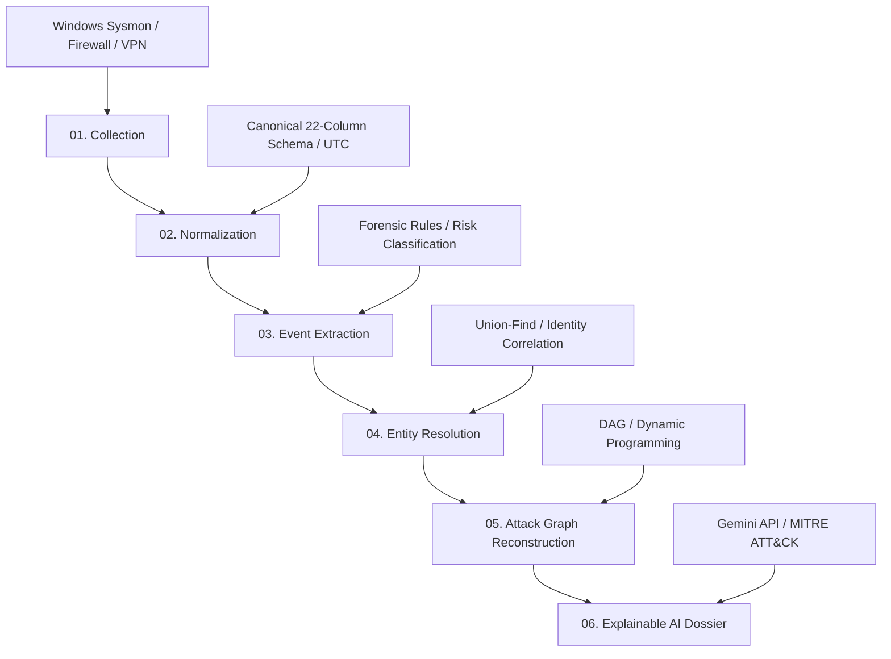

 <div align="center">


<br/>


<br/><br/>


<br/><br/>

**Turning fragmented security logs into a connected attack story.**

</div>

---

## 📌 Overview

**CHIMERA** is an AI-powered digital forensic investigation platform designed to transform fragmented cybersecurity logs into connected attack narratives.

Modern cyberattacks often involve multiple suspicious activities spread across users, devices, processes, and networks. CHIMERA correlates these events, reconstructs potential attack sequences, identifies the initial compromised entity (Patient Zero), and evaluates the potential impact of an attack.

By combining machine learning, graph algorithms, forensic rule-based analysis, and AI-assisted reporting, CHIMERA helps security analysts move beyond isolated alerts toward explainable cyber investigations.

---

## 🚨 The Problem

Cybersecurity environments generate thousands of security alerts every day. However, sophisticated attacks rarely appear as a single obvious event.

Consider the following scenario:

- An employee logs in from an unusual geographic location.
- A suspicious PowerShell command executes on an endpoint.
- An unfamiliar service account accesses a database.
- An attacker moves laterally across the network.
- Security logs arrive in different formats and out of chronological order.

Individually, these events may appear harmless. Together, they can reveal a coordinated cyberattack.

**The challenge:** Traditional security monitoring often struggles to connect fragmented events into a complete attack story.

## 💡 Our Solution

CHIMERA introduces a six-stage forensic investigation pipeline that transforms raw security telemetry into actionable investigation intelligence.

<div align="center">

**COLLECT → NORMALIZE → EXTRACT → CORRELATE → RECONSTRUCT → REPORT**

</div>

---

## ⚙️ Core Features

| Feature | Description |
|---|---|
| 🔍 Temporal Anomaly Detection | Identifies suspicious activity patterns across time, including out-of-order events. |
| 🔗 Event Correlation | Connects users, devices, IP addresses, processes, and VPN sessions. |
| 🕸️ Attack Graph Reconstruction | Reconstructs potential attack sequences using directed graph analysis. |
| 🎯 Patient Zero Identification | Identifies the potentially compromised starting entity. |
| 🌐 Blast Radius Analysis | Estimates the scope of affected accounts, devices, and services. |
| 🧠 Evasion Detection | Infers potentially missing attack stages from suspicious evidence. |
| 📑 AI Investigation Dossier | Generates incident briefs with raw log references and MITRE ATT&CK mappings. |

---

## 🏗️ System Architecture

CHIMERA follows a six-stage investigation pipeline.



### Pipeline Breakdown

**01. Collection**
- Ingests heterogeneous security logs.
- Supports Windows Sysmon, Firewall, and VPN log sources.
- Preserves original raw records.

**02. Normalization**
- Converts different log formats into a unified 22-column schema.
- Standardizes timestamps into UTC.
- Handles clock drift and inconsistent event ordering.

**03. Event Extraction**
- Applies deterministic forensic rules.
- Classifies events into risk levels:
  - Benign
  - Suspicious
  - High

**04. Entity Resolution**
- Uses Union-Find clustering.
- Correlates usernames, IP addresses, devices, and VPN sessions.
- Creates unified identity relationships.

**05. Attack Graph Reconstruction**
- Builds a time-ordered directed acyclic graph (DAG).
- Connects suspicious activities through graph relationships.
- Uses dynamic programming to identify maximum-suspicion chains.
- Infers potentially evaded attack stages.

**06. Explainable AI Dossier**
- Calculates the Attack Confidence Index (ACI).
- Generates AI-assisted executive incident briefs.
- Provides raw log references and MITRE ATT&CK technique mappings.
- Produces investigation and containment recommendations.

---

## 🕸️ Attack Graph Reconstruction

One of CHIMERA's central capabilities is converting isolated security events into a connected attack path.

### Graph Components

| Component | Meaning |
|---|---|
| Nodes | Users, workstations, processes, servers, and external IPs |
| Edges | Suspicious actions connecting entities across time |
| Patient Zero | Initial compromised entity |
| Blast Radius | Potentially affected accounts, devices, and services |

### Example Attack Scenario

```text
             jsmith @ PC-001
                    |
                    ▼
           PowerShell Execution
                    |
                    ▼
              LSASS Dumping
                    |
                    ▼
               VPN Pivot
                    |
                    ▼
             Database Server
                    |
                    ▼
             External C2 Server
               45.33.32.150
```

This example illustrates how CHIMERA can connect multiple suspicious events into a potential coordinated attack sequence.

---

## 🧰 Technology Stack

| Technology | Application |
|---|---|
| Python | Core development and forensic processing |
| Pandas | Log ingestion, transformation, and normalization |
| NetworkX | Graph construction and attack-path analysis |
| Scikit-learn | Isolation Forest-based anomaly filtering |
| Streamlit | Interactive investigation dashboard |
| PyVis | Interactive attack graph visualization |
| Google Gemini API | AI-assisted incident summaries |
| MITRE ATT&CK | Threat technique mapping and explainability |

---

## 🧠 What Makes CHIMERA Different?

| Traditional Monitoring | CHIMERA |
|---|---|
| Examines individual alerts | Connects fragmented security events |
| Struggles with delayed logs | Handles out-of-order telemetry |
| Requires manual correlation | Uses entity resolution and graph analysis |
| Limited attack-path visibility | Reconstructs potential attack sequences |
| Alert-focused investigation | Explainable forensic investigation |
| Primarily monitoring-oriented | Read-only investigation copilot |

### Key Differentiators

- **Connected Intelligence:** Converts fragmented events into a coherent attack narrative.
- **Forensic Explainability:** Supports findings with original log references.
- **Graph-Based Investigation:** Uses graph mathematics to analyze attack relationships.
- **Advisory Architecture:** Read-only investigation approach without automated system modifications.
- **No Retraining Requirement:** Uses MITRE ATT&CK knowledge and graph-based techniques without requiring model retraining for each investigation.

---

## 📊 Project Highlights

| Capability | Project-reported result |
|---|---:|
| Benign telemetry pruning | 99.4% |
| Evasion detection confidence | 93% |
| Canonical log schema | 22 columns |
| Investigation pipeline | 6 stages |
| Blast radius scoring | 0–100 |

*Note: These figures are reported in the project presentation and should be interpreted in the context of the project's evaluation methodology and test data.*


## 🚀 Getting Started

### Prerequisites

- Python 3.10 or compatible version
- Git
- pip
- Google Gemini API key (for AI-assisted reporting)

### 1. Clone the Repository

```bash
git clone https://github.com/twinklee176/chimera-cyber-investigator.git
```

### 2. Navigate to the Project Directory

```bash
cd chimera-cyber-investigator
```

### 3. Create a Virtual Environment

```bash
python -m venv venv
```

Activate the environment:

**Windows**
```bash
venv\Scripts\activate
```

**Linux / macOS**
```bash
source venv/bin/activate
```

### 4. Install Dependencies

If `requirements.txt` is included:

```bash
pip install -r requirements.txt
```

### 5. Configure Environment Variables

Configure the Google Gemini API key securely if AI-assisted reporting is enabled.

Never upload API keys, credentials, or `.env` files containing secrets to GitHub.

### 6. Launch the Application

For a Streamlit application, use the actual dashboard entry-point filename:

```bash
streamlit run app.py
```

*Replace `app.py` if your project's entry-point filename is different.*

---

## 🔮 Future Scope

- Integration with additional enterprise security log sources.
- Enhanced real-time event correlation.
- Improved interactive attack graph visualization.
- Expanded threat intelligence integration.
- Advanced forensic investigation and reporting.
- Enhanced investigation workflows for SOC analysts.

---

## 👥 Team & Acknowledgements

<div align="center">


<br/><br/>


<a href="https://github.com/twinklee176">
  
</a>
&nbsp;&nbsp;&nbsp;&nbsp;
<a href="https://github.com/kashvinayak20-debug">
  
</a>
&nbsp;&nbsp;&nbsp;&nbsp;
<a href="https://github.com/rajshree077">
  
</a>
&nbsp;&nbsp;&nbsp;&nbsp;
<a href="https://github.com/anmisha-dash">
  
</a>


<br/>
<a href="https://github.com/twinklee176">**Twinkle Mahato**</a>
&nbsp; • &nbsp;
<a href="https://github.com/kashvinayak20-debug">**Kashvinayak**</a>
&nbsp; • &nbsp;
<a href="https://github.com/rajshree077">**Rajshree**</a>
&nbsp; • &nbsp;
<a href="https://github.com/anmisha-dash">**Anmisha**</a>


<br/><br/>

<sub>Four minds. One mission. Smarter cyber investigations.</sub>

</div>

**Original Repository:** [Chimera Cyber Investigator](https://github.com/kashvinayak20-debug/chimera-cyber-investigator)

**Independent Repository Maintainer:** [@twinklee176](https://github.com/twinklee176)

This repository is an independent copy of the original collaborative project, maintained for continued development and portfolio purposes. Original commit authorship and project contributions are retained.

---

## ⚠️ Disclaimer

CHIMERA is intended for authorized cybersecurity investigation, digital forensics, and educational purposes.

Its findings are advisory and should be validated by qualified security professionals before making incident-response decisions.

---

<div align="center">


<br/><br/>

**🛡️ Built for smarter cyber investigations.**


</div>
