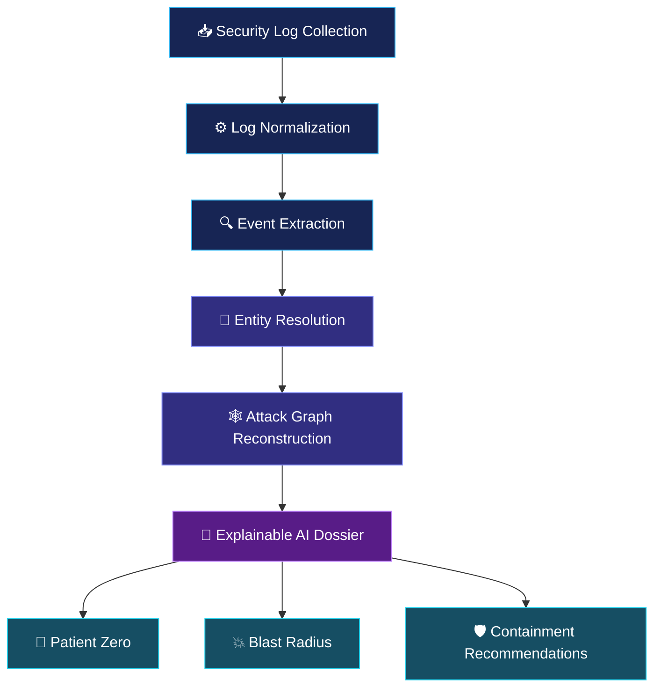

 <!-- ===================== HEADER ===================== -->

<div align="center">


<br/>


<br/><br/>


<br/><br/>

**Turning fragmented security logs into a connected attack story.**

</div>

---

## 🧬 About CHIMERA

**CHIMERA** is an AI-powered cyber investigation platform designed to transform fragmented security logs into meaningful attack narratives.

Modern cyberattacks generate enormous amounts of security telemetry across multiple systems. These events are often scattered, delayed, and stored in different formats, making it difficult for security analysts to understand the complete attack sequence.

CHIMERA addresses this challenge by collecting, normalizing, correlating, and reconstructing security events into a connected attack graph.

It helps investigators understand:

- 🔍 What happened?
- 🕵️ Where did the attack originate?
- 🔗 How did the attacker move between systems?
- 🎯 Which users, devices, and services were affected?
- 🛡️ What actions should be considered for containment?

---

## ⚡ Core Capabilities

<table>
<tr>
<td width="50%">

### 🔎 Intelligent Log Analysis

Analyzes heterogeneous security logs from multiple sources.

</td>
<td width="50%">

### 🧩 Entity Resolution

Correlates users, IP addresses, devices, and VPN sessions.

</td>
</tr>
<tr>
<td width="50%">

### 🕸️ Attack Graph Reconstruction

Builds a time-ordered graph of suspicious activities.

</td>
<td width="50%">

### 🎯 Patient Zero Detection

Identifies the suspected initial compromised entity.

</td>
</tr>
<tr>
<td width="50%">

### 💥 Blast Radius Analysis

Helps visualize potentially affected accounts, devices, and services.

</td>
<td width="50%">

### 🤖 Explainable AI Dossier

Generates investigation insights with supporting log references.

</td>
</tr>
</table>

---

## 🏗️ System Architecture

CHIMERA follows a six-stage investigation pipeline:



### 🔄 Investigation Workflow

| Stage | Description |
|---|---|
| 01. Collection | Collects Windows Sysmon, Firewall, and VPN logs |
| 02. Normalization | Converts different log formats into a canonical schema |
| 03. Event Extraction | Identifies suspicious activities using forensic rules |
| 04. Entity Resolution | Connects related IPs, users, devices, and sessions |
| 05. Graph Reconstruction | Builds a time-ordered attack graph |
| 06. AI Dossier | Presents explainable investigation findings |

---

## 🕸️ Attack Graph Reconstruction

CHIMERA connects isolated security events to reveal potential attack progression.

**Example investigation scenario:**

```text
        👤 jsmith@PC-001
                |
                ▼
       ⚠️ Suspicious PowerShell
                |
                ▼
       🔐 LSASS Credential Dump
                |
                ▼
          🌐 VPN Pivot
                |
                ▼
        🗄️ Database Server
                |
                ▼
        🚨 External C2 Server
         45.33.32.150
```

The reconstructed graph helps investigators follow suspicious activity across multiple entities and systems.

---

## 🛠️ Technology Stack

<div align="center">

### Programming & Data Processing


### Machine Learning & Graph Analysis


### Dashboard & Visualization


### AI & Threat Intelligence


</div>

---

## 📊 Key Investigation Insights

- **Temporal Anomaly Detection:** Helps identify unusual event sequences and timing.
- **Attack Sequence Reconstruction:** Connects suspicious activities across systems.
- **Patient Zero:** Highlights the suspected initial compromised entity.
- **Blast Radius:** Provides a 0–100 impact score as described in the project design.
- **Evasion Detection:** Helps identify potentially skipped or concealed attack stages.
- **Explainability:** Provides investigation findings with supporting log references and MITRE ATT&CK mappings.

<sub>Note: Numerical performance figures presented in the hackathon presentation are project-reported results and should not be interpreted as independently validated benchmarks.</sub>

---

## 🧰 Getting Started

### 1. Clone the Repository

```bash
git clone https://github.com/twinklee176/chimera-cyber-investigator.git
```

### 2. Navigate to the Project

```bash
cd chimera-cyber-investigator
```

### 3. Create a Virtual Environment

```bash
python -m venv venv
```

Activate it:

**Windows**

```bash
venv\Scripts\activate
```

**Linux / macOS**

```bash
source venv/bin/activate
```

### 4. Install Dependencies

```bash
pip install -r requirements.txt
```

### 5. Configure Environment Variables

Create a `.env` file if the application uses API credentials:

```env
GEMINI_API_KEY=your_api_key_here
```

Do not commit API keys or other secrets to GitHub.

### 6. Run the Application

If your Streamlit entry point is `app.py`:

```bash
streamlit run app.py
```

> Verify the actual dependency filename and application entry point in the repository before running these commands.

---

## 📸 Project Preview

Add your actual application screenshots inside the `assets` folder.

<div align="center">

### Main Dashboard


### Attack Graph Visualization


### Patient Zero Analysis


### Investigation Report


</div>

---

## 🚀 Future Enhancements

- Real-time security log ingestion
- Integration with additional SIEM platforms
- Advanced threat intelligence enrichment
- Interactive attack graph exploration
- Automated incident response workflows
- Enhanced investigation report generation

---

## 👩‍💻 Project Contributors

CHIMERA was developed as a collaborative hackathon project.

<div align="center">

<a href="https://github.com/twinklee176">
  
</a>
<a href="https://github.com/kashvinayak20-debug">
  
</a>
<a href="https://github.com/rajshree077">
  
</a>
<a href="https://github.com/anmisha-dash">
  
</a>

<br/>

| Contributor | GitHub |
|---|---|
| **Twinkle Mahato** | [@twinklee176](https://github.com/twinklee176) |
| Kashvinayak | [@kashvinayak20-debug](https://github.com/kashvinayak20-debug) |
| Rajshree | [@rajshree077](https://github.com/rajshree077) |
| Anmisha | [@anmisha-dash](https://github.com/anmisha-dash) |

</div>

---

## ⚠️ Disclaimer

CHIMERA is an academic and hackathon project intended for cybersecurity investigation and educational purposes. Its findings are investigative indicators and should be reviewed by qualified security professionals before any operational decisions are made.

---

<div align="center">

### 🧬 CHIMERA — Connect the Clues. Reconstruct the Attack.


</div>
